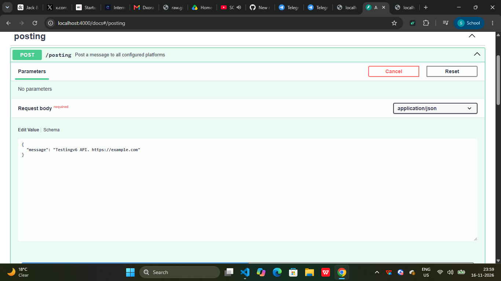
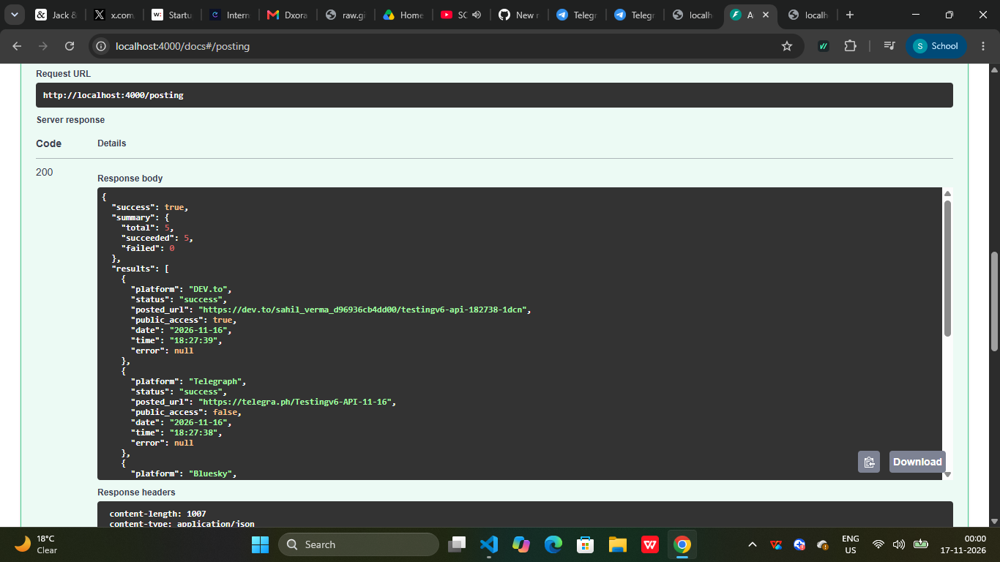
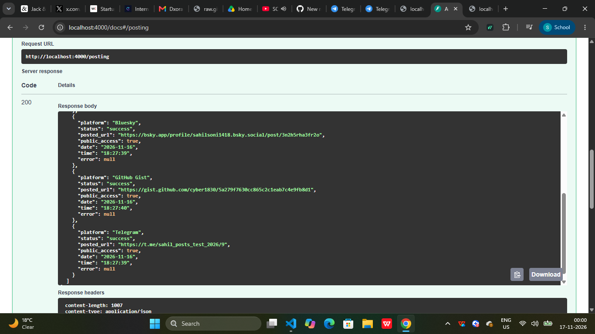

# Automated Multi-Platform Posting

This project exposes a small FastAPI service for publishing one short message to five platforms:

- DEV.to
- Telegraph
- Bluesky
- GitHub Gist
- Telegram

Each platform is handled independently. If one service rejects a post or is not configured, the remaining platforms still receive the message.

## Requirements

- Python 3.10 or newer
- API credentials for the platforms you want to use

## Run locally

```bash
python -m venv .venv

# Windows
.venv\Scripts\activate

# macOS/Linux
source .venv/bin/activate

pip install -r requirements.txt
cp .env.example .env
```

Add your credentials to `.env`, then start the server:

```bash
uvicorn app.main:app --host 0.0.0.0 --port 4000
```

The interactive API documentation is available at <http://localhost:4000/docs>.

## Credentials

| Platform | Environment variables |
| --- | --- |
| DEV.to | `DEVTO_API_KEY` |
| Telegraph | `TELEGRAPH_ACCESS_TOKEN` |
| Bluesky | `BLUESKY_IDENTIFIER`, `BLUESKY_APP_PASSWORD` |
| GitHub Gist | `GITHUB_TOKEN` |
| Telegram | `TELEGRAM_BOT_TOKEN`, `TELEGRAM_CHANNEL_USERNAME` |

Telegraph access tokens can be created with:

```text
https://api.telegra.ph/createAccount?short_name=AutomatedPosting&author_name=YourName
```

Never commit `.env` or share API tokens. The repository includes `.env.example` with empty values.

## API usage

### `POST /posting`

Example request:

```json
{
  "message": "Check out our latest business platform. https://example.com"
}
```

The message must contain exactly one valid `http` or `https` link and must not exceed 200 characters.

Each result contains `platform`, `status`, `posted_url`, `public_access`, `date`, `time`, and `error`. The request returns one result per platform, and:

```text
total = succeeded + failed
```

## Example run

The following output was captured from a live run:

```text
POST /posting
Status: 200 OK

Total platforms: 5
Succeeded: 5
Failed: 0

[SUCCESS] DEV.to
URL: https://dev.to/sahil_verma_d96936cb4dd00/testing-v5-180033-3jbj
Public access: true

[SUCCESS] Telegraph
URL: https://telegra.ph/Testing-v5-11-16
Public access: false

[SUCCESS] Bluesky
URL: https://bsky.app/profile/sahilsoni1418.bsky.social/post/3n2h4azrmux2t
Public access: true

[SUCCESS] GitHub Gist
URL: https://gist.github.com/cyber1830/c0b21382c60e25a342278385308038e1
Public access: true

[SUCCESS] Telegram
URL: https://t.me/sahil_posts_test_2026/8
Public access: true
```

Telegraph returned a valid page URL, but the unauthenticated public-access check returned `false` in this run. Publishing itself succeeded.

## Screenshots

These screenshots show the request in Swagger UI and the complete successful response:







## Project structure

```text
app/
├── main.py
├── schemas.py
├── config.py
├── validators.py
├── platforms/
│   ├── base.py
│   ├── devto.py
│   ├── telegraph.py
│   ├── bluesky.py
│   ├── github_gist.py
│   ├── telegram.py
│   └── __init__.py
└── services/
    └── posting_service.py
```

## Tests

```bash
pip install -r requirements-dev.txt
pytest
```

The tests cover validation, platform adapters, timeout handling, failure isolation, and secret-safe error responses. HTTP calls are mocked, so real credentials are not needed for the tests.
